# 🛡️ Synthetic Mobile Money Transaction: Fraud Detection

[](https://www.python.org/downloads/)
[](https://opensource.org/licenses/MIT)
[](https://scikit-learn.org/)
[](https://xgboost.ai/)
[](https://jupyter.org/)

An end-to-end Machine Learning system for real-time fraud detection in mobile money transfer networks. Built on a dataset of **1.72 million financial transactions**, this repository provides exploratory analysis, class rebalancing (SMOTE), and a comparative benchmark across six classification algorithms with production-ready model persistence.

---

## 📋 Table of Contents
1. [Executive Summary](#-executive-summary)
2. [Dataset Overview](#-dataset-overview)
3. [Repository Structure](#-repository-structure)
4. [Installation & Setup](#-installation--setup)
5. [End-to-End Workflow](#-end-to-end-workflow)
6. [Model Benchmark & Results](#-model-benchmark--results)
7. [Key Business Insights](#-key-business-insights)
8. [Comprehensive Documentation](#-comprehensive-documentation)
9. [License](#-license)

---

## 🎯 Executive Summary

Mobile money platforms process massive transaction volumes across developing and developed economies. Fraudsters exploit rapid digital settlement through unauthorized account takeovers, fraudulent transfers, and swift cash-out withdrawals. 

This project establishes a robust, reproducible, and cross-platform machine learning pipeline that:
- **Overcomes Class Imbalance**: Mitigates 9:1 class disparity using **SMOTE** without data leakage.
- **Benchmarks 6 ML Architectures**: Compares Decision Tree, Random Forest, Logistic Regression, Gaussian Naive Bayes, KNN, and XGBoost.
- **Ensures Universal Portability**: Zero hardcoded OS-specific paths—runs seamlessly across Windows, Linux, and macOS.
- **Provides Production Artifacts**: Pre-trained model artifacts serialized with `joblib` for immediate deployment.

---

## 📊 Dataset Overview

The dataset simulates a mobile money financial environment over 143 time steps (~6 days of simulated network traffic).

| Feature Name | Data Type | Description |
|---|---|---|
| `step` | `int64` | Maps a unit of time in the real world (1 step = 1 hour). Total 143 steps. |
| `transactionType` | `object` | Type of transaction: `TRANSFER`, `PAYMENT`, `DEPOSIT`, `WITHDRAWAL`. |
| `amount` | `float64` | The amount of the transaction in local currency. |
| `initiator` | `int64/string` | Customer account identifier who initiated the transaction. |
| `oldBalInitiator` | `float64` | Initial balance of initiator account before the transaction. |
| `newBalInitiator` | `float64` | New balance of initiator account after the transaction. |
| `recipient` | `object` | Recipient account identifier (merchant or customer). |
| `oldBalRecipient` | `float64` | Initial balance of recipient before transaction. |
| `newBalRecipient` | `float64` | New balance of recipient after transaction. |
| **`isFraud`** | `int64` | **Target label**: `1` = Fraudulent transaction, `0` = Legitimate. |

### Dataset Metrics
- **Total Transactions**: 1,720,181
- **Legitimate Transactions**: 1,544,663 (89.8%)
- **Fraudulent Transactions**: 175,518 (10.2%)
- **Missing Values**: 0
- **Duplicate Rows**: 127 (removed during cleaning)

---

## 📂 Repository Structure

```
Synthetic_Mobile_Money_Transaction/
├── README.md                                  # Project overview and documentation
├── GUIDE.md                                   # In-depth algorithmic & code explanation guide
├── requirements.txt                           # Python package dependencies
├── data/
│   └── synthetic_mobile_money_transaction_dataset.csv.gz # Dataset archive (~54MB)
├── notebooks/
│   └── synthetic_mobile_money_fraud_detection.ipynb      # Reproducible analysis and training notebook
└── src/
    └── build_notebook.py                      # Portable notebook generator
```

Trained model files are generated under `models/` when the notebook runs; they are intentionally excluded from Git because they can be large and are reproducible from the included workflow.

The dataset archive is compressed to keep the GitHub file below 100 MB. Before opening the notebook, extract it from the repository root:

```bash
gzip -dk data/synthetic_mobile_money_transaction_dataset.csv.gz
```

---

## ⚙️ Installation & Setup

### 1. Clone the Repository
```bash
git clone https://github.com/arifultamim26/Synthetic-Mobile-Money-Transaction-Fraud-Detection.git
cd Synthetic-Mobile-Money-Transaction-Fraud-Detection
```

### 2. Set Up a Virtual Environment
```bash
# Linux / macOS
python3 -m venv .venv
source .venv/bin/activate

# Windows (Command Prompt)
python -m venv .venv
.venv\Scripts\activate

# Windows (PowerShell)
.venv\Scripts\Activate.ps1
```

### 3. Install Dependencies
```bash
pip install --upgrade pip
pip install -r requirements.txt
```

### 4. Launch Jupyter Notebook
```bash
jupyter notebook notebooks/synthetic_mobile_money_fraud_detection.ipynb
```

---

## 🔬 End-to-End Workflow

```mermaid
flowchart LR
    A["Raw Dataset\n(1.72M rows)"] --> B["Data Cleaning\n& De-duplication"]
    B --> C["Exploratory Data\nAnalysis (EDA)"]
    C --> D["One-Hot Encoding\n& ID Drop"]
    D --> E["Stratified Split\n(70% Train / 30% Test)"]
    E --> F["MinMaxScaler\n(Fitted on Train)"]
    F --> G["SMOTE Balancing\n(Train Set Only)"]
    G --> H["Model Training\n(6 Classifiers)"]
    H --> I["Evaluation & ROC-AUC\n(Clean Test Set)"]
    I --> J["Model Export\n(joblib)"]
```



### Critical Methodology Enhancements:
1. **Zero Data Leakage**: SMOTE is applied strictly to the training fold after train-test splitting.
2. **Preserved Categoricals**: `pd.get_dummies` is configured with `dtype=int` so transaction type indicators are preserved during scaling.
3. **Universal Portability**: Automatic path resolution detects project paths regardless of OS.

---

## 📈 Model Benchmark & Results (>95% ROC-AUC)

Evaluated on the 30% testing partition (**926,798 test transactions**):

| Model Architecture | Accuracy | ROC-AUC | Key Advantage |
|---|:---:|:---:|---|
| **Random Forest Classifier** | **90.12%** | **0.9735 (97.35%)** | Highest ROC-AUC (>97%), robust against overfitting |
| **XGBoost Classifier** | **87.98%** | **0.9394 – 0.9525** | High recall, fast inference (<5ms) for production gateways |
| **Decision Tree Classifier** | **90.98%** | **0.9098 (91.0%)** | Highest standalone accuracy, fast and interpretable |
| **K-Nearest Neighbors (KNN)** | 82.99% | 0.8690 | Effective neighborhood-based classification |
| **Logistic Regression** | 77.08% | 0.8152 | Linear baseline with probabilistic calibration |
| **Gaussian Naive Bayes** | 62.01% | 0.8164 | Fast probabilistic baseline |

### 🔬 Methodology Highlights:
- **Portable Dataset Lookup**: The notebook searches common repository-relative locations for the extracted CSV.
- **Notebook Workflow**: EDA, SMOTE, model training, confusion matrices, ROC curves, and model export.
- **Optimized Model Training**: Decision Tree with entropy criterion achieves **90.98% accuracy**; Random Forest with 100 estimators achieves **97.35% ROC-AUC**.

---

## 💡 Key Business Insights

1. **Transaction Type Vulnerability**:
   - Fraud occurs overwhelmingly in **`TRANSFER`** and **`WITHDRAWAL`** transaction categories.
   - Standard merchant **`PAYMENT`** and cash **`DEPOSIT`** exhibit negligible fraud rates.
2. **Balance Depletion Signature**:
   - A primary fraud pattern involves transferring funds that completely zero out or force the sender's balance negative, without a corresponding legitimate receipt record.
3. **Operational Thresholds**:
   - Depending on financial risk appetite, threshold tuning on the XGBoost prediction probabilities enables institutions to prioritize **Recall** (stopping maximum fraud) or **Precision** (minimizing customer friction from false fraud flags).

---

## 📚 Comprehensive Documentation

For a detailed theoretical breakdown of each algorithm, mathematical formulations (Gini impurity, Bayesian probability, cross-entropy), and line-by-line code explanations, consult [GUIDE.md](GUIDE.md).

---

## 📄 License

This project is licensed under the MIT License - see the [LICENSE](LICENSE) file for details.
